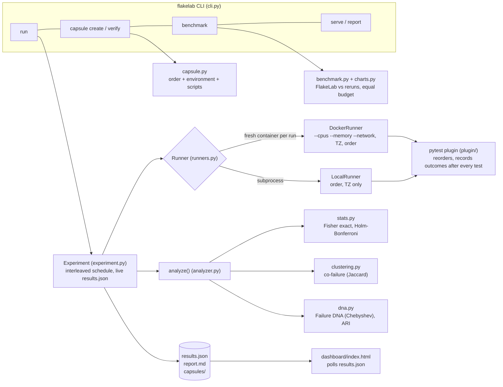
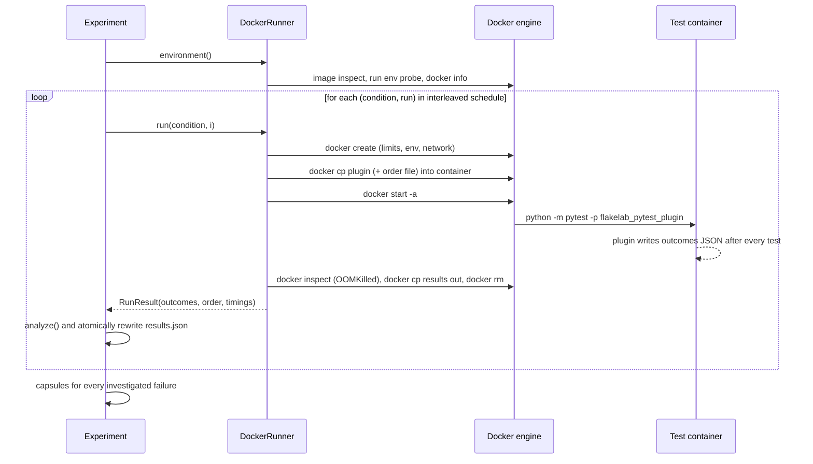
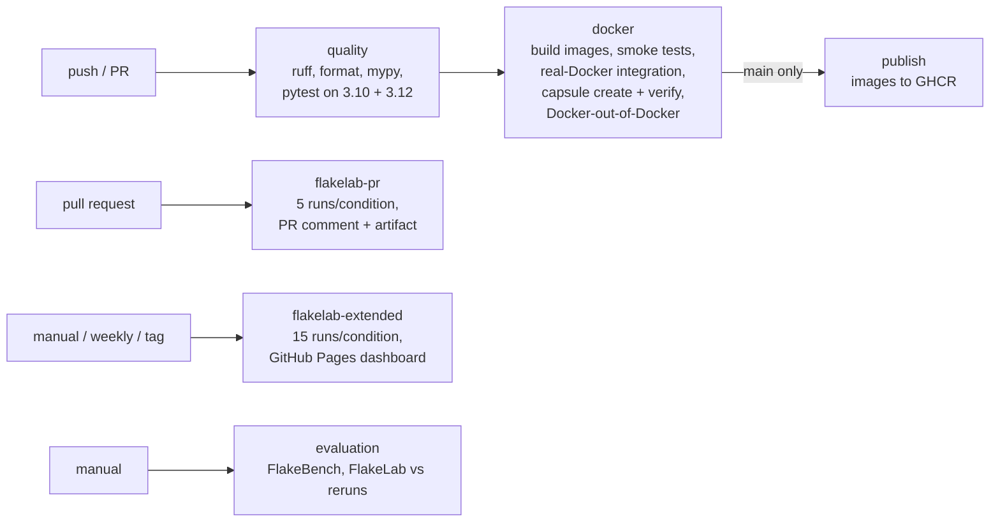

# FlakeLab architecture

## Components



## One experiment run, step by step



## CI/CD pipeline



## Modules

| Module | Responsibility | Key ideas |
|---|---|---|
| `conditions.py` | What each experiment changes | one variable per condition; baseline pins TZ and order |
| `runners.py` | Execute the suite once | fresh container per run, plugin injected with `docker cp`, OOM detection, environment capture |
| `plugin/flakelab_pytest_plugin.py` | Inside the project's pytest | reverse / seeded shuffle / explicit replay; atomic write after every test (crash attribution) |
| `experiment.py` | Orchestration | interleaved schedule, thread pool (default 1 worker), live results, timing, capsules |
| `stats.py` | Statistics | one-sided Fisher exact test from the hypergeometric distribution; Holm-Bonferroni |
| `analyzer.py` | Verdicts | confirmed observation / supported hypothesis / unknown; evaluation against ground truth |
| `clustering.py` | Generic clustering | average-linkage agglomerative with cached distances; Jaccard co-failure groups |
| `dna.py` | Failure DNA | per-condition failure-rate signatures, Chebyshev distance, cluster evidence, ARI |
| `capsule.py` | Reproduction capsules | failing-order prefix, environment, scripts, statistical `verify` |
| `benchmark.py`, `charts.py` | Evaluation | equal-budget comparison with reruns, SVG charts, EVALUATION.md |
| `report.py` | Markdown | PR comments and CI job summaries |
| `cli.py` | Entry point | input validation, subcommands |

## Data model (`results.json`)

```
meta        tool, version, runner, target, status, runs_per_condition, alpha, seed,
            conditions[{name,label,category,description,docker_args,env}],
            environment{image, project{python, os, packages}, host, revision},
            timing{wall, mean_run, mean_pytest, mean_overhead, flakelab_cpu, max_rss},
            capsules[{test, path}]
tests[]     nodeid, per_condition{cond: {runs, failures, rate}}, observations[],
            verdict{level, categories, title, explanation, fix}, reproduce,
            hidden_sensitivity, dna[rates], dna_cluster, cluster
dna         conditions, threshold, clusters[{signature, spread, common_conditions,
            evidence, co_failure_similarity, confidence, limitations}], quality{ARI}
clusters[]  co-failure groups
summary     counts
evaluation  (with --expected) accuracy, false positives, inconclusive rate, ...
runs[]      every run: condition, index, outcomes, order, order_env, durations, notes
```

## Design decisions

| Decision | Why | Alternative rejected |
|---|---|---|
| Fresh container per run | no state leaks between runs; each run is an independent sample | reuse one container: faster, but leaked state breaks independence |
| Inject plugin with `docker cp` | works with any project image, no rebuild | require users to add the plugin to their image |
| Write outcomes after every test, atomically | an OOM kill mid-run still tells us which test was running | write once at the end: a crash loses the whole run |
| Interleave conditions | slow drift (heat, background load) spreads over all conditions | blocks per condition: drift would look like an effect |
| One worker by default | parallel runs compete for CPU and blur CPU experiments | parallel by default: faster but confounded |
| Standard library only | installs anywhere, works offline at the expo | scipy / FastAPI / React: more dependencies, no gain for the experiment |
| Static dashboard polling JSON | zero server logic, works from GitHub Pages and offline | web app with an API |
| Docker-out-of-Docker via socket | FlakeLab's container controls sibling containers | Docker-in-Docker: privileged, slower, nested storage |
