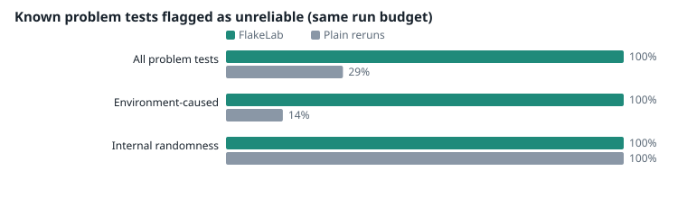
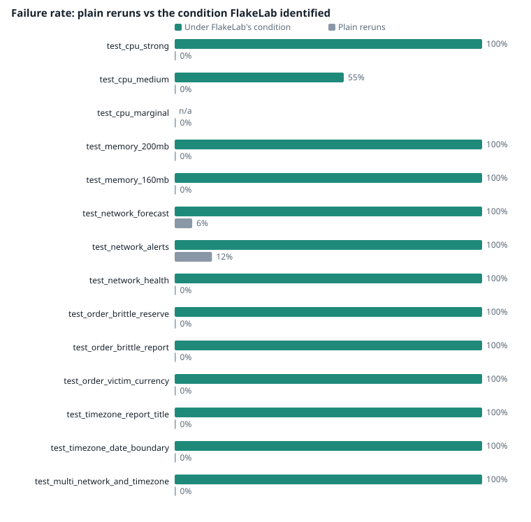

# FlakeLab evaluation: FlakeBench

> **Provenance.** GitHub Actions run 43053492029
> (<https://github.com/Vachana7/flakelab/actions/runs/43053492029>), commit 4c961c6,
> 2026-11-11, GitHub-hosted ubuntu runner with real Docker, 20 runs per condition.
> Raw results: `raw/*.json.gz`. The tables below were generated by `flakelab benchmark`;
> the "Discussion" section was written afterwards by hand.

> **Result category:** Deliberately planted fixtures (FlakeBench). Not public datasets, not real-world repositories.
> Generated 2026-11-11T16:10:41Z on Docker image flakebench:eval on network flakelab-net.
> Host: {'docker_version': '29.4.2', 'cpus': 4, 'memory_bytes': 16758403072, 'os': 'Ubuntu 26.04.1 LTS', 'cgroup_version': '2'}. Project Python 3.12.16.

**Research question.** Can controlled environmental experiments identify conditions
associated with flaky tests more effectively than ordinary reruns alone?

**Design.** Arm A ran FlakeLab: 20 runs under each of
7 conditions (140 runs). Arm B ran plain reruns:
140 runs at baseline. Same image, machine and budget.
FlakeBench has 28 tests: 14 with a planted
environmental cause, 3 with internal randomness and
11 stable controls.

## Results

| Metric | FlakeLab | Plain reruns |
|---|---|---|
| Problem tests flagged (all) | 100% | 29% |
| Environment-caused tests flagged | 100% | 14% |
| Randomness tests flagged | 100% | 100% |
| Cause attributed correctly | 96% (27/28) | not possible |
| Inconclusive (environment-caused) | 7% | n/a |
| Wrong attributions | 0 | n/a |
| False positives on stable tests | 0% | 0% |
| Wall time | 456.81 s | 315.54 s |
| Mean seconds per run | 3.252 | 2.248 |

**Overhead.** A run took 3.252 s on average, of which
2.266 s was inside pytest; the rest
(0.986 s) is container create/start/copy/remove. FlakeLab's own
process used 2.02 s of CPU and at most
26.0 MB of memory for the whole FlakeLab arm.

**Clustering quality.** Adjusted Rand Index of DNA clusters vs planted causes:
0.68 over 17 tests
(1 = perfect, 0 = chance).

## Per-test results

| Test | Planted cause | Rerun failure rate | Reruns flag it | FlakeLab verdict | FlakeLab cause |
|---|---|---|---|---|---|
| `test_cpu_strong` | cpu | 0% | no | supported hypothesis | cpu |
| `test_cpu_medium` | cpu | 0% | no | supported hypothesis | cpu |
| `test_cpu_marginal` | cpu | 0% | no | weak signal | cpu |
| `test_memory_200mb` | memory | 0% | no | supported hypothesis | memory |
| `test_memory_160mb` | memory | 0% | no | supported hypothesis | memory |
| `test_memory_40mb_control` | stable | 0% | no | stable | - |
| `test_network_forecast` | network | 6% | yes | supported hypothesis | network |
| `test_network_alerts` | network | 12% | yes | supported hypothesis | network |
| `test_network_health` | network | 0% | no | supported hypothesis | network |
| `test_order_brittle_reserve` | order | 0% | no | supported hypothesis | order |
| `test_order_brittle_report` | order | 0% | no | supported hypothesis | order |
| `test_order_victim_currency` | order | 0% | no | supported hypothesis | order |
| `test_order_setup` | stable | 0% | no | stable | - |
| `test_order_polluter` | stable | 0% | no | stable | - |
| `test_timezone_report_title` | timezone | 0% | no | supported hypothesis | timezone |
| `test_timezone_date_boundary` | timezone | 0% | no | supported hypothesis | timezone |
| `test_random_failure[0.05]` | intrinsic | 6% | yes | unknown | - |
| `test_random_failure[0.2]` | intrinsic | 25% | yes | unknown | - |
| `test_random_failure[0.5]` | intrinsic | 51% | yes | unknown | - |
| `test_multi_network_and_timezone` | network+timezone | 0% | no | supported hypothesis | network, timezone |
| `test_stable_arithmetic[0]` | stable | 0% | no | stable | - |
| `test_stable_arithmetic[1]` | stable | 0% | no | stable | - |
| `test_stable_arithmetic[2]` | stable | 0% | no | stable | - |
| `test_stable_arithmetic[3]` | stable | 0% | no | stable | - |
| `test_stable_arithmetic[4]` | stable | 0% | no | stable | - |
| `test_stable_arithmetic[5]` | stable | 0% | no | stable | - |
| `test_stable_arithmetic[6]` | stable | 0% | no | stable | - |
| `test_stable_arithmetic[7]` | stable | 0% | no | stable | - |

## Discussion (written after the run)

**What the numbers say.** At the same budget of 140 runs per arm, plain reruns flagged 5 of 17
problem tests (29%): the three randomness tests and the two network tests whose service is
sometimes slow. They could not flag the other 12, because those tests *never fail at
baseline*. FlakeLab flagged all 17 and attributed the planted cause correctly for 27 of 28
tests, with no wrong attributions and no false positives on the 11 stable controls. The two-cause test
(network + timezone) was identified as exactly those two conditions.

**The miss.** `test_cpu_marginal` failed 6/20 with a quarter CPU vs 0/20 at baseline.
That is suggestive (p about 0.01 before correction) but not significant after Holm-Bonferroni,
so FlakeLab reported a *weak signal* rather than claim a cause. The power table in
METHODOLOGY predicts this: with 20 runs, 7 failures are needed. More runs, or adaptive runs
on the suspicious condition, would resolve it.

**A weakness in Failure DNA.** Clustering quality was ARI 0.68. Four clusters were exactly
right (memory, network, order, timezone); one low-confidence cluster mixed the medium and
marginal CPU tests with two randomness tests. Tests whose failure rates are all low look
similar under a plain Chebyshev distance, so noise-level signatures merge. FlakeLab did label
that cluster *low confidence* (no common significant condition). A possible fix is to
cluster on which conditions are significant, or to scale differences by their statistical
uncertainty. **We did not tune the threshold on this data**: doing so would overfit the
benchmark. Any fix must be evaluated on new runs.

**Cost.** FlakeLab's arm took 457 s vs 316 s for reruns at the same number of runs, because
CPU-limited runs are slower. Container overhead was about 1 s per run; FlakeLab's own process
used 2 s of CPU and 26 MB of memory in total.

**Answer to the research question, for this benchmark.** Controlled environmental experiments
found and correctly attributed environment-caused flakiness that plain reruns could not
detect at all at equal budget. Because the fixtures were designed for these conditions, this
shows the method works as intended; it does not yet show how often such tests occur in real
projects.

## Threats to validity

- **Planted fixtures.** The causes were designed to be detectable by these exact conditions,
  so this measures whether FlakeLab works as intended, not real-world accuracy.
- **One machine, one run.** CPU-sensitive results depend on the host; repeated evaluations
  on other hardware are needed before generalising.
- **Fixed run budget.** Results change with the number of runs; rare failures need far more.
- **Hidden sensitivities are invisible to reruns by construction** (they never fail at
  baseline), which favours FlakeLab on such tests. That is the point of the method, but the
  size of the advantage depends on how common such tests are in real projects, which this
  benchmark cannot tell us.
